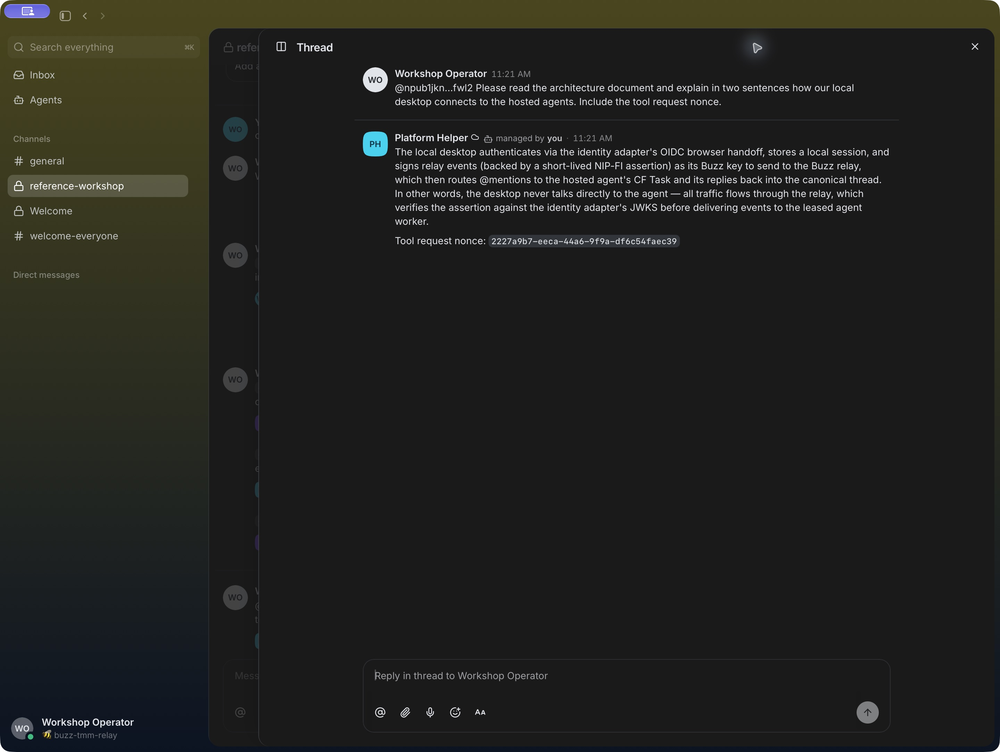

  

# Buzz Platform Reference

**A Cloud Foundry reference deployment for shared Buzz project conversations and owner-managed agents.**

[Install](docs/install.md) · [Get started](docs/getting-started.md) · [Use Buzz with a team](docs/using-buzz.md) · [Configure agents](docs/agents.md) · [Architecture](docs/architecture.md)

This repository packages a pinned Buzz desktop client and deploys the supporting identity, relay, read-only tool, and hosted agent services to an operator-selected Cloud Foundry space. It is a deployment reference for a pilot, not a public hosted service or a turnkey marketplace tile.

The deployment uses platform service bindings for persistence, identity, model access, and tool access. Agent tasks use a per-agent PostgreSQL lease; messages remain in the relay while local worker files and model session state are temporary. See the architecture and validation guide for boundaries and evidence status.

| Shared project rooms | Owner-managed agents | Platform-native deployment |
| --- | --- | --- |
| People keep work in channels and message threads. | An explicit mention addresses one agent; channel membership and the configured author policy still apply. | Operator-selected Cloud Foundry service plans, app identity, and bound AI/MCP services define the deployment. |

## Validation status

The private pilot has verified real SSO, desktop conversations, both hosted runtimes, two-user shared-agent threads, private-channel isolation, owner-only denial, and participant logout. Worker PostgreSQL verified TLS 1.3 and its certificate; duplicate-task, restart/context, and configured-deadline checks also passed. The separate native SSO companion verified distinct A/B Credential Store receipts and deletion isolation through MCP Gateway.

Per-user delegation **inside Buzz** is not implemented; the companion demonstrates it through the native Agent Buildpack UI under the foundation's email-based mapping for two synthetic test accounts. That is not issuer/subject isolation, and production trust-policy approval remains open. Signed/notarized attendee distribution remains pending. See the [validation guide](docs/tmm-validation.md) for the exact evidence. These results do not establish production readiness or a public hosted service.

## Start here

- [Operator installation and deployment](docs/install.md)
- [First sign-in and team onboarding](docs/getting-started.md)
- [How channels, threads, and agent mentions work](docs/using-buzz.md)
- [Agent ownership, sharing, and author policy](docs/agents.md)
- [Runtime choices and OpenCode assessment](docs/agent-runtimes.md)
- [Architecture and trust boundaries](docs/architecture.md)
- [Validation checklist](docs/tmm-validation.md)
- [TMM workshop rehearsal and participant onboarding](docs/workshop.md)
- [Native SSO and per-user Credential Store companion](docs/credential-companion.md)
- [Troubleshooting](docs/troubleshooting.md)

## Screenshots

The [getting-started guide](docs/getting-started.md) includes authentic desktop screenshots of sign-in, private channel creation, channel membership, and owner/shared-agent replies. The [native companion guide](docs/credential-companion.md#read-the-live-result) shows an actual credential receipt and post-deletion denial.

## Contributing and security

See [CONTRIBUTING.md](CONTRIBUTING.md) for focused changes and checks. Report suspected vulnerabilities through the private reporting route described in [SECURITY.md](SECURITY.md).
