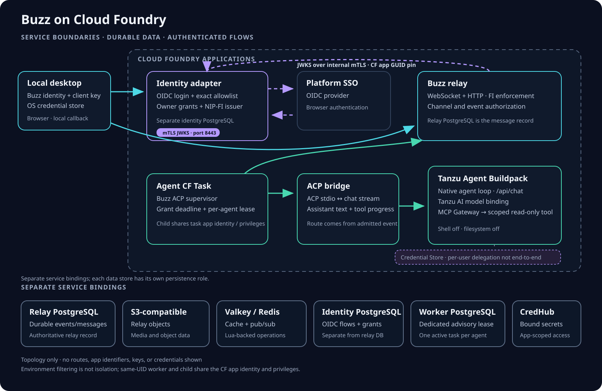
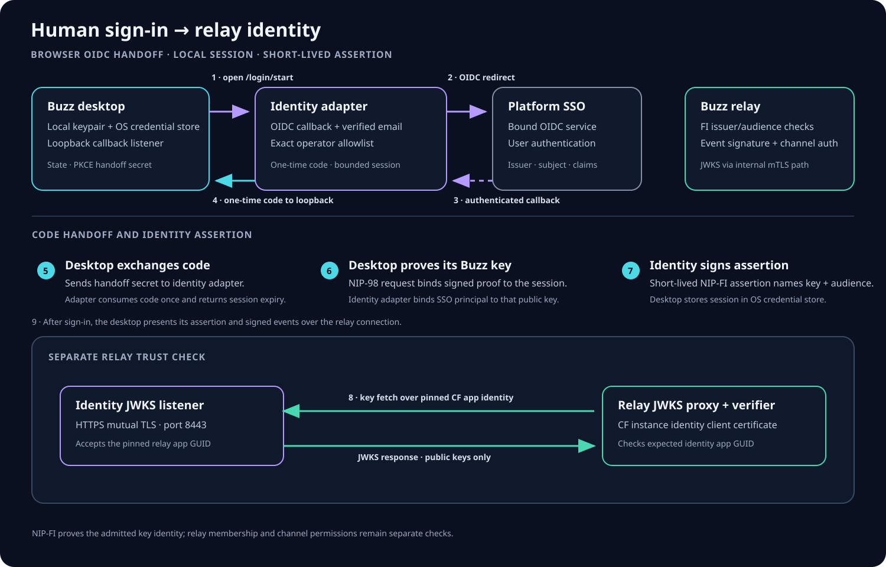
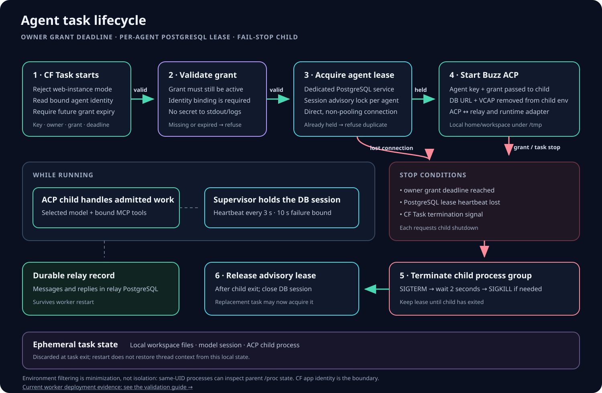
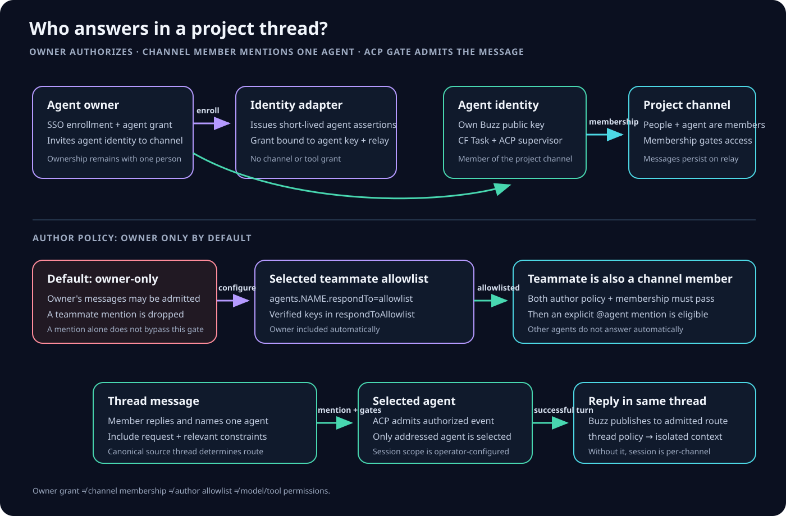
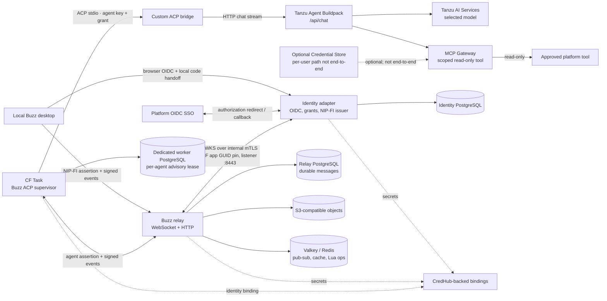
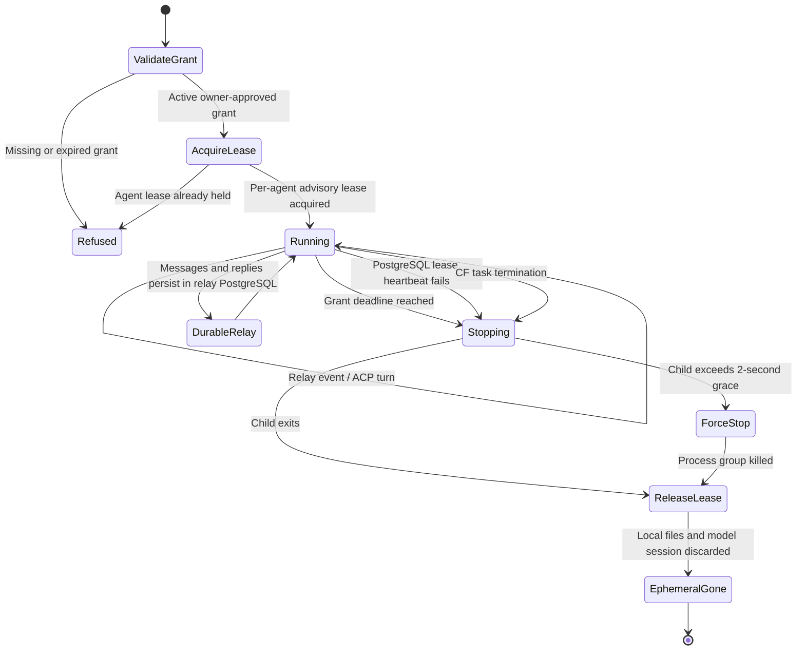
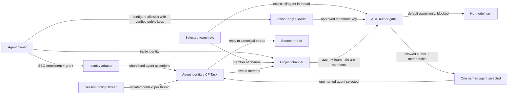

# Architecture

This page describes the Cloud Foundry reference topology and its identity,
agent, and team-message paths. The diagrams show service boundaries and data
flow; they do not represent a live deployment or imply that an operator has
completed the deployment checklist.

## At a glance



The relay, identity adapter, and agent worker use separate PostgreSQL
services. Relay messages are durable in relay PostgreSQL. Relay objects use an
S3-compatible object store; Valkey (Redis protocol) supports cache, pub/sub,
and Redis-side Lua operations. Signing and service credentials are supplied
through CredHub-backed bindings. The worker's local files and model sessions
are ephemeral.

The relay obtains the identity adapter's public signing keys through an
internal JWKS route: a relay-side proxy connects to the identity app's mTLS
listener on port 8443. Each side validates the expected Cloud Foundry app GUID.
This protects the JWKS fetch path; the relay still verifies each signed
assertion under the configured issuer and audience rules.

The hosted agent flow is a CF Task running the Buzz ACP supervisor. Its custom
ACP adapter calls the native Tanzu Agent Buildpack chat API; the Buildpack
agent loop calls the explicitly bound model and MCP Gateway. The current
platform-agent configuration disables shell and filesystem access and binds a
scoped read-only tool. These controls apply to the separate Buildpack app. A
Credential Store binding can support outbound user SSO token forwarding when
an authenticated Buildpack user session exists, but the Buzz ACP-to-`/api/chat`
path does not establish that session. Per-user Credential Store delegation is
optional and is not implemented end to end.

## Cloud Foundry apps, buildpacks, or a tile?

Deploy Buzz's identity adapter, relay, and read-only tool backend as ordinary
Cloud Foundry apps, and run each hosted agent as a CF Task. The Node services
use the existing Node.js buildpack; the separate model-facing app uses the
existing Tanzu Agent Buildpack. PostgreSQL, Redis/Valkey, object storage, SSO,
AI models, MCP Gateway, Credential Store, and CredHub are consumed through the
foundation's Marketplace service brokers.

This reference does not add a custom Buzz tile or a general Buzz buildpack.
App manifests already express the routes, bindings, network policy, runtime
configuration, and task lifecycle needed here. A dedicated tile is a later
productization choice only if Buzz becomes a foundation-wide operator-managed
service with a stable service lifecycle and support contract.

## Human sign-in and relay identity



The desktop opens a system browser to the identity adapter. The adapter uses
the bound platform SSO service and OIDC authorization-code flow with PKCE,
state, and nonce. After the callback, it validates the verified email against
its exact operator allowlist and returns a short-lived, single-use code to the
desktop's loopback callback. The desktop exchanges that code for a local
session, stores the session in the OS credential store, and signs a NIP-98
request for a short-lived human NIP-FI assertion. The relay checks that
assertion against the identity adapter's JWKS.

The assertion identifies a Buzz public key already proven by the desktop. It
does not grant channel membership or replace the relay's own channel
authorization checks. SSO identity and Buzz key identity are bound by the
identity adapter; the relay remains responsible for event signatures and
channel access.

## Agent work and lifecycle



An owner-authorized identity binding supplies the agent key, owner key, grant,
and grant deadline to the CF Task. The task refuses expired grants, acquires a
dedicated PostgreSQL advisory lease for the agent, and starts the Buzz ACP
supervisor only while it holds that lease. Lease heartbeat loss or grant
expiry stops the child process. Lease loss requests graceful termination,
then kills the process group after two seconds; at the grant deadline it kills
the group immediately. The task releases the lease only after the child group
exits.

This is best-effort duplicate suppression, not partition fencing or an
exactly-once execution guarantee. A stalled process can retain its lease and
require operator task cancellation. The reference's read-only tool avoids
irreversible external writes; adding write-capable tools requires their own
idempotency and authorization controls.

The task strips its worker-database connection, full CF binding document, and
PostgreSQL connection variables from the ACP child's environment. The child
does receive the agent identity and grant material needed for relay
authentication. Environment filtering reduces accidental exposure; it is not a
security boundary between same-UID processes, which may inspect parent
`/proc` state. The CF app identity and trusted developers in its space are the
isolation boundary. Arbitrary code in a worker tool can exercise the worker's
app privileges. In the separate native Buildpack app, shell and filesystem
tools are disabled; its tools run with that app's own identity and bindings.

The task's working directory, files, and provider session live only for that
task run. Relay events and replies remain in the relay's PostgreSQL store. In
the private pilot, after a controlled Helper restart the agent recalled a prior
thread nonce from relay history, while a fresh top-level thread returned a
distinct `NEW_THREAD` response. This confirms transcript-backed context for
those cases; it does not make local files or the provider session durable. A
thread-scoped ACP session policy is set by the activation helper.

The worker implementation defines advisory-lock and fail-stop mechanics. The
private pilot verified Helper and Researcher worker turns and TLS 1.3 with a
verified certificate in the Helper's worker PostgreSQL connection. It also
verified duplicate-task refusal and a controlled Helper restart. The diagram
describes the wider intended task contract; it does not establish every edge
as live-tested. An isolated CF Task verified shutdown at the configured
worker deadline with synthetic child processes, not an issuer-expired grant
in a Buzz conversation. TLS is not claimed for the unchanged relay and
identity PostgreSQL instances.

## Team and thread workflow



An agent remains owned by one person. The owner enrolls its key through SSO
and grants the identity service permission to issue short-lived assertions.
The owner invites that agent identity to a project channel. The ACP author gate
defaults to `owner-only`; selected teammates can be admitted by setting
`agents.NAME.respondTo` to `allowlist` and listing verified Buzz public-key
hex values in `agents.NAME.respondToAllowlist` in the private deployment
config. Each teammate must also be a member of the channel. A mention selects
the named agent but grants neither channel membership nor new tools. Other
agents do not answer automatically.

For conversations, a top-level agent mention starts a thread. A mention or
reply inside an existing thread is routed back to that canonical thread. Set
`BUZZ_ACP_SESSION_POLICY=thread` to give each channel thread isolated model
context; the activation helper sets this policy for named agents. If an agent
is launched outside that helper, verify its session policy. Direct messages
remain conversation-scoped.

## Status and configuration boundaries

| Area | What the source supports | What still needs verification |
| --- | --- | --- |
| Relay | PostgreSQL event store, S3-compatible object storage, Valkey-compatible Redis, CredHub-backed secrets | Rendered bindings, routes, and service policy in the target space |
| Identity | OIDC login, scoped agent grants, signed NIP-FI assertions, dedicated PostgreSQL state | Real SSO, allow/deny behavior, key rotation, and mTLS JWKS on the target deployment |
| Agent | Helper/Tanzu and Researcher/built-in owner-authorized turns, worker PostgreSQL TLS 1.3 certificate verification, duplicate-task refusal, controlled restart, live configured-deadline canary | Two-human allowlist, issuer-expired grant in a real conversation, relay/identity database TLS, and full signed desktop distribution |
| Desktop | Local OIDC browser handoff and OS credential-store session handling | Signed/notarized distribution and a sanitized end-user onboarding run |
| Credential Store | Optional native Buildpack support for outbound SSO credential forwarding | Per-user delegation through the Buzz ACP runtime is not implemented end to end |

No private route, account identifier, app GUID, key, token, or credential is
part of these diagrams. Operators render those values from their own
deployment configuration.

## Mermaid source

The following source blocks mirror the SVG diagrams and are kept here for
review and future edits.

### Platform components



### Human sign-in

```mermaid
sequenceDiagram
  actor Human
  participant Desktop as Local Buzz desktop
  participant Identity as Identity OIDC adapter
  participant SSO as Platform SSO
  participant IdentityDB as Identity PostgreSQL
  participant Relay as Buzz relay

  Human->>Desktop: Start platform sign-in
  Desktop->>Desktop: Bind loopback callback; create state and PKCE handoff challenge
  Desktop->>Identity: Open /v1/login/start with callback and S256 challenge
  Identity->>IdentityDB: Store one-time browser flow
  Identity-->>SSO: Redirect using OIDC state, nonce, and PKCE
  Human->>SSO: Authenticate
  SSO-->>Identity: OIDC authorization callback
  Identity->>Identity: Verify OIDC claims and exact email allowlist
  Identity->>IdentityDB: Store single-use handoff code
  Identity-->>Desktop: Redirect to loopback callback with code
  Desktop->>Identity: Exchange code and handoff secret
  Identity->>IdentityDB: Consume code; create bounded session
  Identity-->>Desktop: Session token and expiry
  Desktop->>Identity: NIP-98 proof for human key assertion
  Identity-->>Desktop: Short-lived NIP-FI assertion
  Desktop->>Relay: Present assertion; sign relay events as Buzz key
  Relay->>Identity: Fetch JWKS via pinned internal mTLS app identity
  Relay->>Relay: Verify issuer, audience, key, and signature
```

### Agent lifecycle



### Team channel and thread



## Source references

- Relay service binding resolution: [`apps/relay/bindings.mjs`](../apps/relay/bindings.mjs)
- OIDC session, human assertion, and agent grant handlers: [`apps/identity/src/server.mjs`](../apps/identity/src/server.mjs)
- Internal JWKS mTLS endpoints: [`server.mjs`](../integrations/cf-mtls/server.mjs), [`proxy.mjs`](../integrations/cf-mtls/proxy.mjs)
- Worker launcher, lease supervisor, and advisory lock: [`launch.mjs`](../apps/agent/launch.mjs), [`worker.mjs`](../apps/agent/worker.mjs), [`lease.mjs`](../apps/agent/lease.mjs), [`lease-config.mjs`](../apps/agent/lease-config.mjs)
- Buildpack ACP bridge: [`buildpack-acp.js`](../integrations/agent/buildpack-acp.js)
- Read-only MCP tool example: [`apps/pilot-mcp/server.mjs`](../apps/pilot-mcp/server.mjs)
