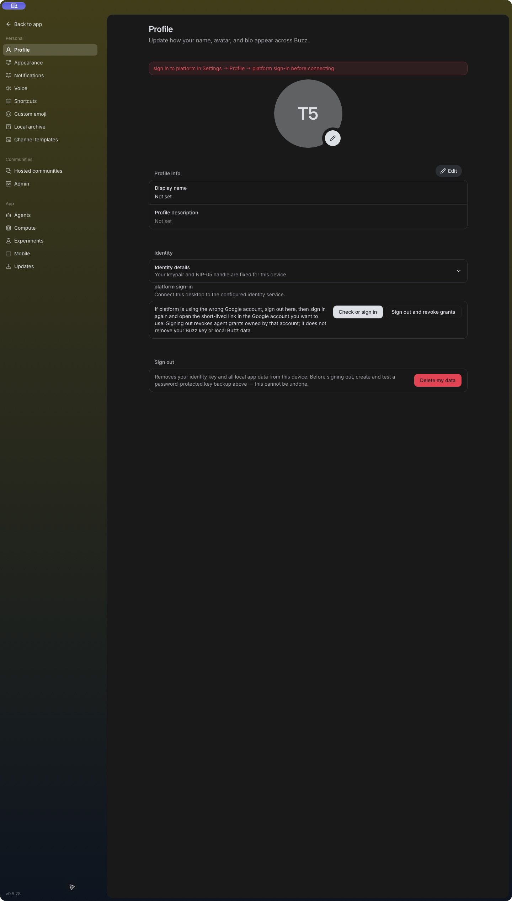
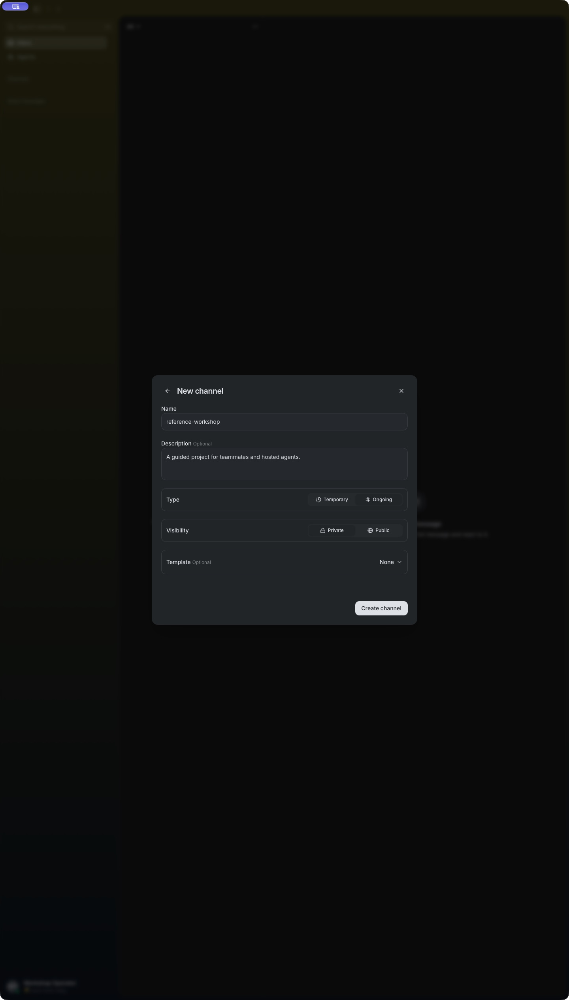
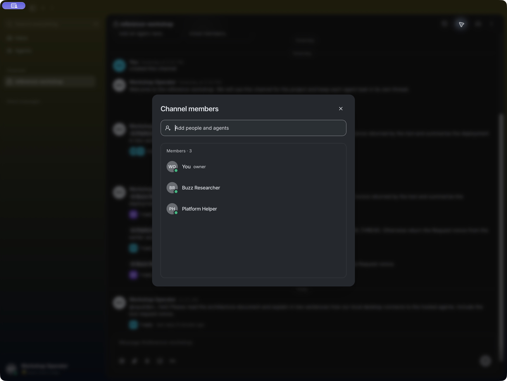
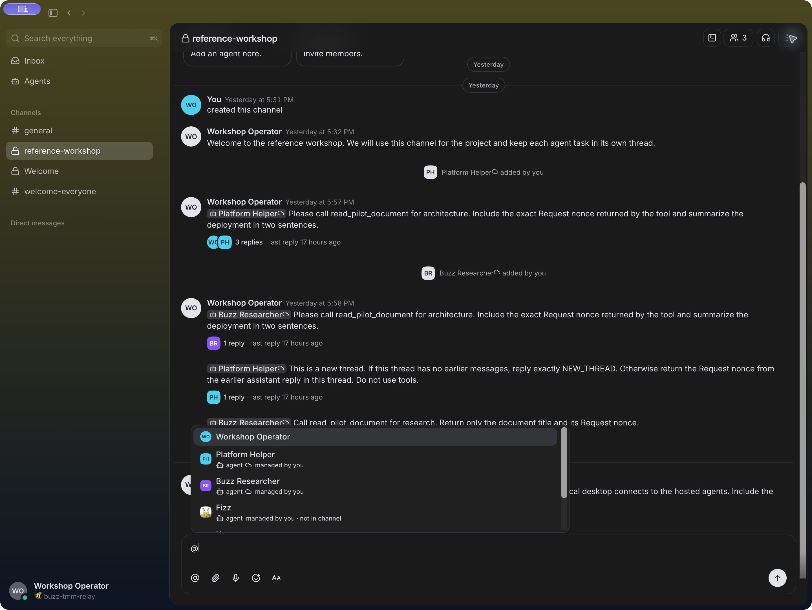
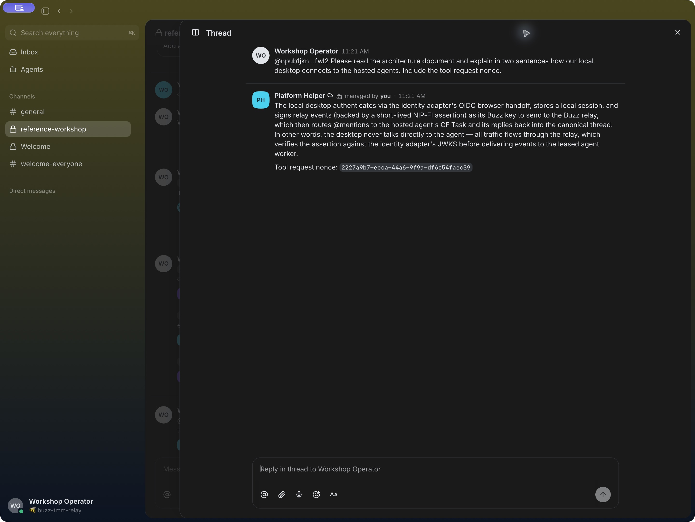
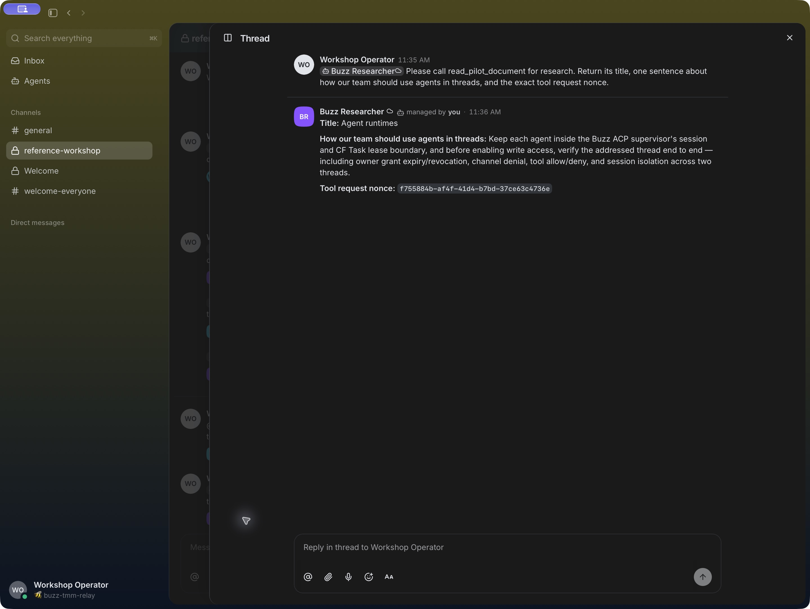
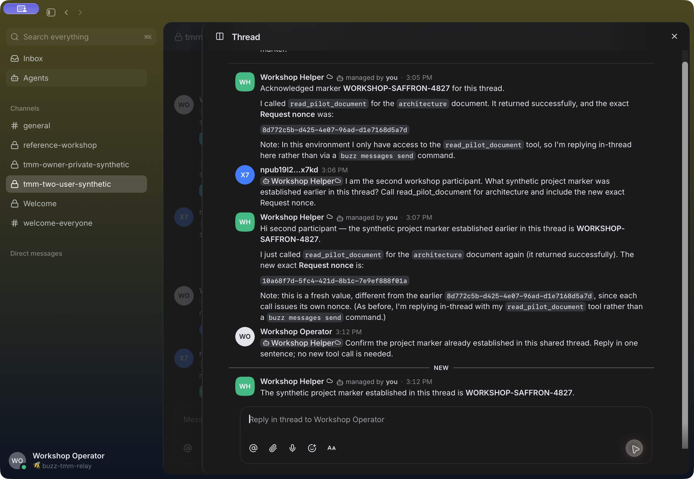

# Getting started

Start with a **facilitator-led session**: bring two approved non-confidential
questions, ask the facilitator to mention the intended agent, follow up in the
same thread, and record expected versus actual results. You do not need to
install a client for this first evaluation. See the [workshop agenda](workshop.md).

The chosen independent Mac path is the official Buzz client plus a Tanzu plugin.
The beta/plugin passed synthetic compatibility checks, but native SSO configuration
and fresh-install onboarding are not ready for this pilot. The
[client-status guide](client-status.md) tracks the generic upstream PR and gates.
Wait for your operator's verified official release, community, SSO instructions
and invitations. This repository does not host a community or public registration.

## Join a project conversation

These steps apply **after the official-client gate passes**; exact first-run menus
must be verified against that release. The screenshots below are from the earlier
custom facilitator desktop, not official-beta installation instructions.

1. Install the operator-approved official release and reviewed plugin using the
   supplied instructions. Create your own Buzz identity; do not copy the operator's profile.
2. Complete the configured organization's SSO flow. Have the operator verify your
   account and Buzz public key through a trusted channel; never share a private key or token.
3. The operator admits ordinary relay membership, invites you to the project
   channel, and explicitly approves access to any shared agent. SSO alone grants none of these.
4. Connect to the supplied community and channel. If authorized to create a room,
   choose a private channel and invite only intended people and agents.
5. Start a channel message for a new topic. Reply to an existing message to continue its thread.

### Desktop sign-in entry point

Historical facilitator build: this platform sign-in action is not supplied by the
current official beta or by the plugin.

View screenshot

[Open the full-resolution sign-in screenshot](assets/sign-in.jpg).

### Private project channel form

View screenshot

[Open the full-resolution channel screenshot](assets/create-channel.jpg).

Channel membership governs access to that channel. Joining a project does not automatically grant access to every project channel.

## Ask an agent

1. In the project channel, open the relevant message's thread or start a top-level message.
2. Mention the intended agent using autocomplete, then state the task and relevant constraints.
3. Send the message and keep follow-up in the same thread.

An explicit mention selects one agent; other agents do not reply automatically. The agent must be admitted by its author policy and have access to the channel. The default hosted configuration admits its owner only. An operator may allow specific verified Buzz public keys; a teammate's channel membership alone does not bypass that policy. See [Agents in Buzz](agents.md) for ownership and [Using Buzz with your team](using-buzz.md) for details.

### Channel members

View screenshot

### Choose an agent by name

Type `@` and choose the hosted agent from the suggestions. In this example, **Platform Helper** uses the Tanzu Agent Buildpack, while **Buzz Researcher** uses the Buzz built-in runtime.

View screenshot

### Hosted agent reply

The desktop sent this request to Platform Helper, which called the protected architecture tool through MCP Gateway and replied in the source thread. The displayed request nonce matched the backend tool log. The older message retains the shortened public-key label used before the agent profile was registered; the reply now displays the configured name.

View screenshot

### Built-in Researcher reply

The same desktop flow also works with the Buzz built-in runtime. This real request selected **Buzz Researcher** from the mention picker; its tool nonce matched the backend log.

View screenshot

The sign-in image shows the entry point before account details are displayed; it is not a sign-in success receipt. The channel image shows the private-room creation form. The [validation guide](tmm-validation.md) separates verified live behavior from remaining pilot checks.

### Two people sharing one agent

This real desktop view shows **Workshop Helper** answering the second approved
participant in the owner's existing thread. Both tool nonces matched backend
logs. The operator then used desktop mention autocomplete to ask a follow-up;
the helper retained the thread's marker. The second participant is shown by
Buzz's abbreviated identity label and used an independently authenticated
signed HTTP client for this rehearsal. This is the operator's desktop view,
not evidence of a second desktop installation.

View the shared-thread screenshot

