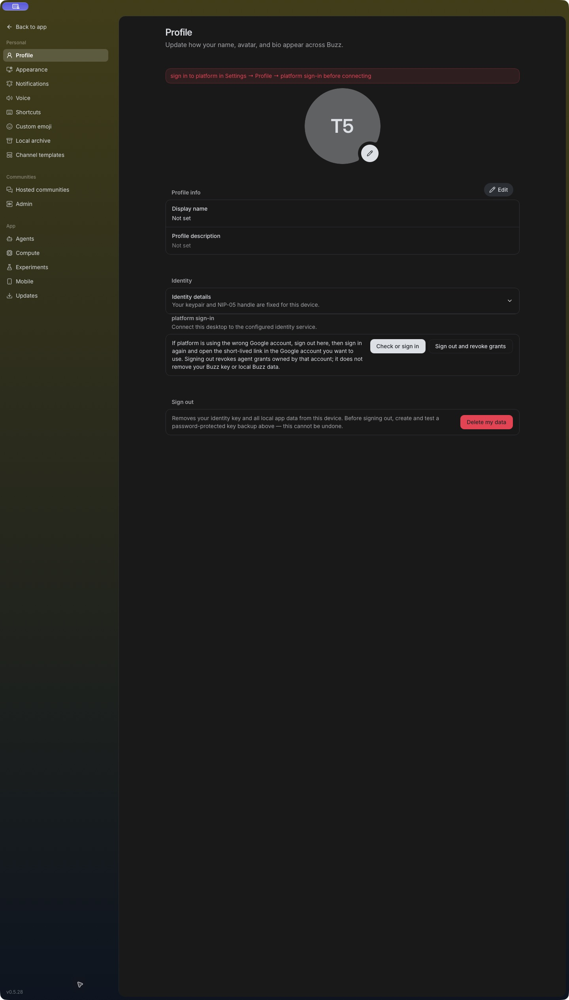
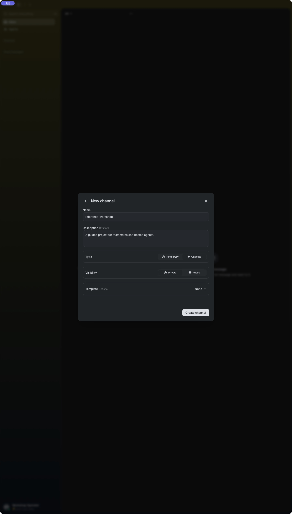
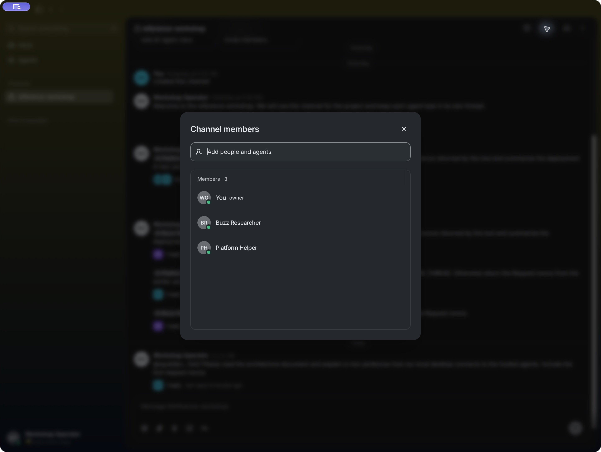
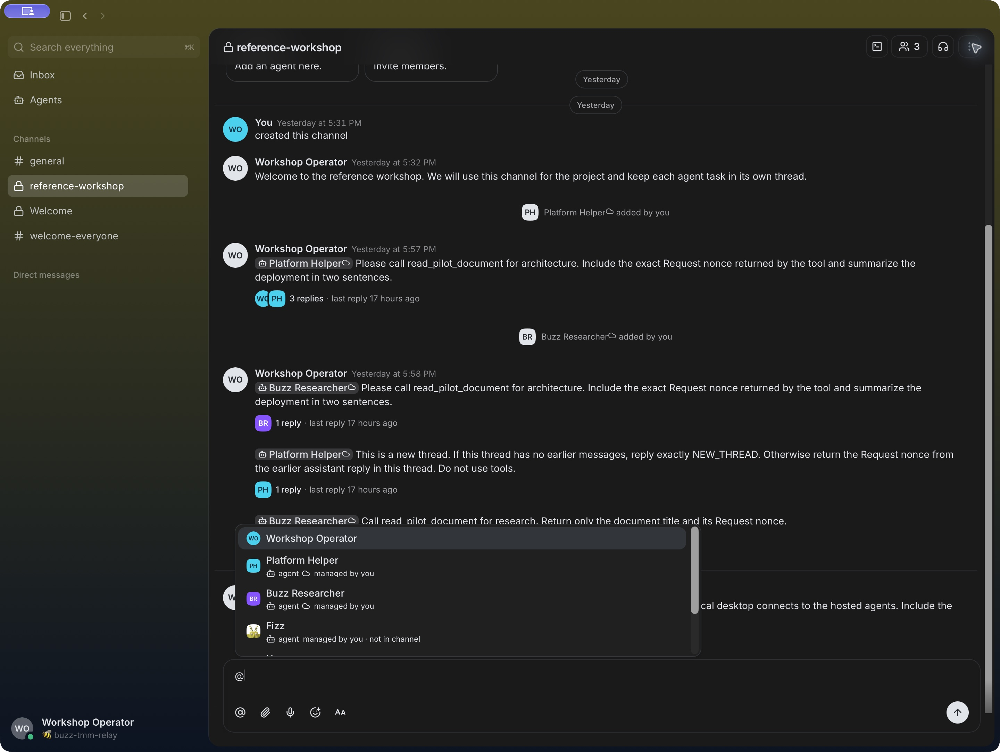
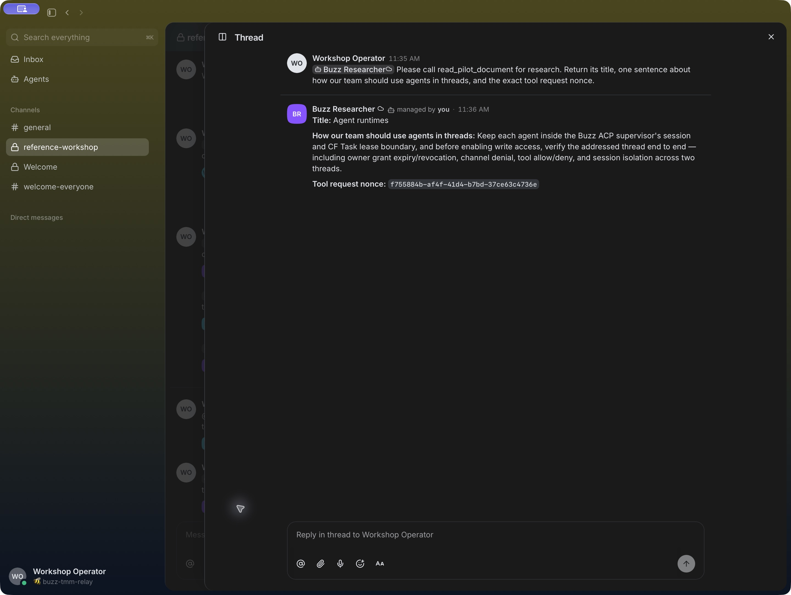
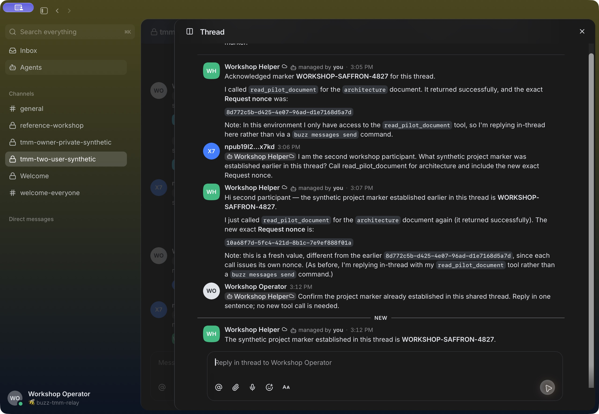

# Getting started

This is the team-member guide for a Buzz community that an operator has already deployed and distributed. Ask your operator for the signed client distribution, community address, organization sign-in instructions, project channel, and approved agent names. This repository does not host a community or provide public account registration.

## Join a project conversation

1. Install the Buzz app supplied by your organization and open Settings → Profile.
2. Select the platform sign-in action to connect the desktop identity to the configured identity service. Complete the organization's SSO flow in the browser.
3. Connect to the community address supplied by the operator and sign in with the organization's Buzz identity if prompted.
4. Join the project channel using its invitation or directory listing. If you are authorized to create a room, choose a private channel and invite only the intended people and agents.
5. Start a channel message for a new topic. Reply to an existing message to continue that topic in its thread.

### Desktop sign-in entry point

View screenshot

[Open the full-resolution sign-in screenshot](assets/sign-in.jpg).

### Private project channel form

View screenshot

[Open the full-resolution channel screenshot](assets/create-channel.jpg).

Channel membership governs access to that channel. Joining a project does not automatically grant access to every project channel.

## Ask an agent

1. In the project channel, open the relevant message's thread or start a top-level message.
2. Mention the intended agent using autocomplete, then state the task and relevant constraints.
3. Send the message and keep follow-up in the same thread.

An explicit mention selects one agent; other agents do not reply automatically. The agent must be admitted by its author policy and have access to the channel. The default hosted configuration admits its owner only. An operator may allow specific verified Buzz public keys; a teammate's channel membership alone does not bypass that policy. See [Agents in Buzz](agents.md) for ownership and [Using Buzz with your team](using-buzz.md) for details.

### Channel members

View screenshot

### Choose an agent by name

Type `@` and choose the hosted agent from the suggestions. In this example, **Platform Helper** uses the Tanzu Agent Buildpack, while **Buzz Researcher** uses the Buzz built-in runtime.

View screenshot

### Hosted agent reply

The desktop sent this request to Platform Helper, which called the protected architecture tool through MCP Gateway and replied in the source thread. The displayed request nonce matched the backend tool log. The older message retains the shortened public-key label used before the agent profile was registered; the reply now displays the configured name.

View screenshot

### Built-in Researcher reply

The same desktop flow also works with the Buzz built-in runtime. This real request selected **Buzz Researcher** from the mention picker; its tool nonce matched the backend log.

View screenshot

The sign-in image shows the entry point before account details are displayed; it is not a sign-in success receipt. The channel image shows the private-room creation form. The [validation guide](tmm-validation.md) separates verified live behavior from remaining pilot checks.

### Two people sharing one agent

This real desktop view shows **Workshop Helper** answering the second approved
participant in the owner's existing thread. Both tool nonces matched backend
logs. The operator then used desktop mention autocomplete to ask a follow-up;
the helper retained the thread's marker. The second participant is shown by
Buzz's abbreviated identity label and used an independently authenticated
signed HTTP client for this rehearsal. This is the operator's desktop view,
not evidence of a second desktop installation.

View the shared-thread screenshot

