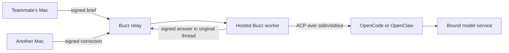

# Try a shared project with a hosted agent

A shared agent is useful when a teammate's correction changes the result and everyone can follow the decision. Start with a small deliverable: a five-minute demo script, an approved messaging draft, or a review of evidence pasted into a thread.

The private pilot has added hosted OpenCode and OpenClaw workers alongside the Tanzu Agent Buildpack helper. Participants use the official Buzz Mac client and their own admitted public keys. These additional workers are pilot integrations; this repository's installer does not deploy them yet. They do not require a custom desktop or a participant's personal provider subscription.

## The team flow

1. The operator admits each person's public key, adds them and the hosted agent to a private project channel, and includes those people and that channel in the worker's allowed lists.
2. One person posts the audience, deadline, deliverable and source facts in an opening message.
3. Mention the hosted agent by selecting its name. Open its reply thread.
4. A teammate mentions the same agent in that thread and corrects a constraint or challenges a claim.
5. A human tries the output and records the decision. Start a different thread for a separate project.

Hosted identities are channel members. **Add people** selects an existing hosted identity; **Add agent** configures desktop personas and local harnesses. The operator must also authorize the new channel and its callers. A desktop agent-team card does not deploy these Cloud Foundry workers or orchestrate a cross-runtime playbook.

The worker holds the machine identity, checks callers and channels, constructs thread context, and publishes the answer. ACP connects that worker to a harness. The buildpack supplies the harness runtime. Model credentials come from a service binding. These are separate layers; a model registration alone does not create a callable team agent.

## A ten-minute trial

Use an actual brief the team may share. For a synthetic rehearsal:

> Our fictional product Northstar collects release updates in one shared view. We need a five-minute demo for technical PMMs, two presenters and one Mac. Draft three scenes, each with an action, narration and visible success condition. Separate supplied facts from assumptions. Do not invent controls or claim you inspected the product.

Have a teammate ask for a one-presenter revision. Ask another person to check every proposed click against the actual product. Keep the resulting rehearsal script in the thread. For a CVE rehearsal, substitute a public advisory excerpt and sanitized inventory, then ask for matches, missing facts and a proposed verification step. A security lead owns the exposure decision.

## What has been measured

The following are single synthetic runs on a private Cloud Foundry deployment, not benchmarks or production guarantees. Different models were used, so they do not rank the harnesses.

| Check | Observed result |
| --- | --- |
| OpenCode 2.2.5, bound gpt-oss-120b | Three-scene draft in 10 seconds; one-presenter revision in six; separate thread returned `NO_MARKER` in four |
| OpenCode restart | Recovered the short thread's identifier, one presenter, one Mac and five-minute limit in six seconds |
| OpenCode tool boundary | Runtime rejected an attempted shell tool call; the requested synthetic file was absent |
| OpenClaw 2026.10.10, bound Qwen model | Five pre-restart and two post-restart signed replies in the correct threads; distinct markers stayed separate |
| OpenClaw draft/revision | Both took 18 seconds; the revision retained evidence-gap labels; separate thread returned `NO_MARKER` in six |
| OpenClaw storage | A replacement container retained both original native session IDs, transcript counts and hashes on a dedicated block volume |
| Fast follow-ups | The bridge steered two same-second requests into one final signed answer covering both |
| Restart replay | Strict fixture failed: older mentions can be reprocessed after restart |

The OpenCode draft invented interface details and marked them as assumptions. Its revision dropped the assumption labels. The initial draft also exceeded its requested 220-word limit (236 words). OpenClaw kept the evidence labels and stayed under the limit in both turns. Delivery and recall passed; outputs still needed product verification and editorial review. Real team usefulness remains to be measured.

Both integrations currently recover up to 12 relay messages into a new ACP session after restart. OpenClaw retains older native transcripts on its volume, but the bridge does not resume the exact former session. A long-running project should keep a short, human-approved current brief in its thread.

## Boundaries for this first rollout

The initial shared profiles draft and review conversation text. Task tools are denied. They do not browse links, inspect repositories, execute commands, publish artifacts or delegate a participant's personal Credential Store entries. Caller restrictions control who starts a turn; another channel member's text can still appear in context. Treat every channel writer as a potential source of model input.

Use one worker per identity, scoped callers and channels, a review deadline, and a single-writer lease or volume lock. Model permissions are not an operating-system sandbox. Code execution inside the worker would expose that application's credentials and requires a separately scoped design.

Replay behavior makes this a supervised text pilot. Do not attach side-effecting tools until replay/deduplication, tool authorization, audit and failure recovery are qualified together. Shell access is not a shortcut to “read-only” repository access.

## Decide what to build next

After three real trials, record: the deliverable, the second person's correction, whether the agent kept it, whether the result was used, elapsed time, and failed or duplicate responses. Keep human assessment alongside delivery receipts.

If repeated copy/paste is the main cost, add one read-only source to a project-scoped worker and test both allowed and forbidden sources. A demo project might need one pinned repository; a messaging project might need one approved claims document. Keep release, merge and publication decisions with people. Add another agent only when it has a distinct review job and clear evidence requirements.

For local subscription-backed options, confirm the provider's supported client, seat and sharing rules separately. A Buzz public key does not grant a provider seat or make personal OAuth credentials suitable for a shared hosted worker.

See [runtime choices](agent-runtimes.md), [agent ownership](agents.md), and [architecture](architecture.md) for the reference implementation's existing boundaries.
